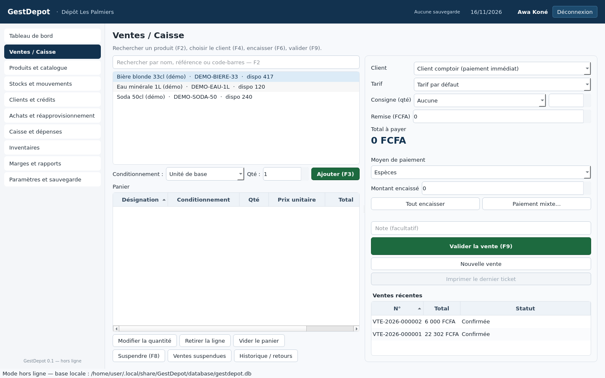
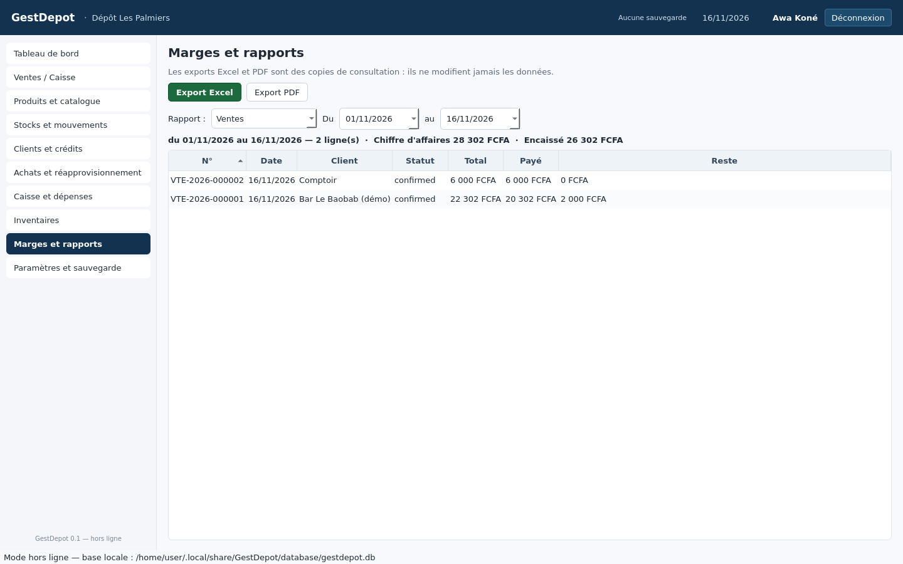

# USER_GUIDE.md — guide utilisateur GestDepot

Interface entièrement en français, devise **FCFA (XOF)**, navigation par le menu
de gauche. L'application fonctionne sans Internet : l'indicateur
« Mode hors ligne » est affiché en bas de la fenêtre.

## 1. Se connecter

1. Lancez GestDepot.
2. Au premier démarrage, l'assistant demande : nom du dépôt, identifiant,
   mot de passe (6 caractères minimum) et éventuellement un code PIN de caisse.
3. Saisissez ensuite votre identifiant et votre mot de passe. Un message neutre
   s'affiche en cas d'erreur ; après plusieurs échecs, la connexion est
   temporairement bloquée.

## 2. Tableau de bord

Choisissez la période (aujourd'hui, hier, 7 derniers jours, mois en cours).
Les cartes affichent le chiffre d'affaires net, la marge brute estimée, le
résultat estimatif de gestion, les créances clients, les dettes fournisseurs et
la valeur du stock. En dessous : les clients débiteurs, les alertes de stock et
les dernières ventes. Tous les chiffres proviennent des opérations enregistrées.

## 3. Préparer le catalogue

Menu **Produits et catalogue** :

1. **Nouveau produit** : référence (unique), désignation, unité de base, seuil
   minimum, prix d'achat courant, catégorie et marque.
2. **Conditionnements** : indiquez par exemple `Casier` × `24`. Ce facteur sert
   à convertir toute vente en unités de base ; il n'est jamais codé en dur.
3. **Tarifs** : un prix par liste (Détail, Gros…) et par conditionnement.
   Sans prix au conditionnement, l'application refuse la vente plutôt que de
   facturer un casier au prix de la bouteille.
4. **Archiver** : un produit déjà utilisé n'est jamais supprimé.

## 4. Réceptionner un achat

Menu **Achats et réapprovisionnement** :

1. **Nouveau fournisseur** si nécessaire.
2. **Nouvelle commande** : produit, quantité en unités de base, prix convenu.
   Une commande **ne modifie pas le stock**.
3. **Réceptionner** : saisissez les quantités réellement reçues. Seules ces
   quantités entrent en stock ; le reliquat reste ouvert pour une réception
   ultérieure. Une facture fournisseur et le solde dû sont créés.
4. L'onglet **À réapprovisionner** propose les produits sous seuil.

## 5. Vendre

Menu **Ventes / Caisse** :

1. Recherchez le produit (nom, référence, code-barres) — raccourci **F2**.
2. Choisissez le conditionnement et la quantité, puis **Ajouter**.
3. Sélectionnez le client (**F4**) ou laissez « Client comptoir ». Le tarif du
   client est appliqué automatiquement ; vous pouvez choisir une autre liste.
4. Une remise en FCFA est possible si votre rôle l'autorise.
5. Choisissez le moyen de paiement (**F6**) : espèces, Orange Money, MTN, Moov,
   Wave, virement, chèque.
6. Saisissez le montant encaissé (ou **Tout encaisser**) puis **Valider (F9)**.
7. **Paiement mixte** : le bouton ouvre la répartition du règlement sur plusieurs
   moyens (par exemple 5 000 en espèces + le reste par Wave). Chaque encaissement
   est numéroté et mouvemente la caisse avec son propre moyen ; le montant total
   ne peut pas dépasser le dû (le rendu de monnaie n'est pas encaissé).

Règles appliquées :

- le stock disponible est vérifié avant validation (vente bloquée si insuffisant) ;
- une quantité nulle ou négative est refusée ;
- une vente à crédit exige un client ; un dépassement de plafond est bloqué sauf
  autorisation du responsable ;
- le prix, la désignation, l'unité et le coût sont figés dans la vente ;
- une vente confirmée ne peut pas être supprimée : elle est annulée ou retournée.

**Modifier la quantité** d'une ligne (ou mettre 0 pour la retirer) et
**Retirer la ligne** agissent sur le panier sans rien écrire en base.

**Suspendre la vente (F8)** met le panier de côté sans toucher au stock, à la
caisse ni aux créances : aucun document n'est numéroté. **Ventes suspendues**
liste les paniers en attente, permet d'en **reprendre** un (il revient dans
l'écran de vente, prêt à être validé) ou d'en **abandonner** un (l'abandon est
inscrit au journal d'audit).

**Imprimer le dernier ticket** génère un ticket 80 mm imprimable
(dossier `documents/`).

## 6. Encaisser une créance

Menu **Clients et crédits** : sélectionnez le client, puis **Encaisser un
règlement**. Le paiement réduit la créance sans modifier le chiffre d'affaires
déjà enregistré. **Relevé de compte** affiche ventes, paiements et retours.

## 7. Retours et annulations

Bouton **Historique / retours** de l'écran de vente : la liste des ventes permet
de choisir **Retour de marchandise** ou **Annuler la vente**.

- Retour : sélectionnez la vente, saisissez les quantités à retourner ligne par
  ligne (les quantités déjà retournées sont affichées et le maximum est borné),
  cochez « revendable » si la marchandise réintègre le stock, indiquez le motif
  et le mode de remboursement (espèces, avoir, autre). Les quantités retournées
  ne peuvent pas dépasser les quantités vendues.
- Annulation : motif obligatoire. Le stock est réintégré, la créance soldée et
  l'opération inscrite au journal d'audit ; le document reste consultable et
  n'est jamais supprimé. La marchandise
revendable réintègre le stock ; la marchandise cassée n'y entre pas. Le
remboursement espèces ne dépasse jamais ce qui a été réellement encaissé.

## 8. Caisse et dépenses

1. **Ouvrir une caisse** : saisissez le fond de caisse compté.
2. Les encaissements espèces alimentent le solde théorique ; les paiements
   Mobile Money et virements sont suivis séparément.
3. **Nouvelle dépense** : catégorie, bénéficiaire, montant, moyen de paiement.
   Une dépense en espèces diminue le solde théorique.
4. **Clôturer la caisse** : saisissez le montant compté ; l'écart est calculé,
   commenté et conservé dans l'historique.

## 9. Inventaires

Menu **Inventaires** : **Nouvel inventaire** fige le stock théorique. Saisissez
les quantités comptées, puis **Valider** : les écarts génèrent des mouvements de
correction tracés. Un inventaire validé n'est plus modifiable.

## 10. Rapports et exports

Menu **Marges et rapports** : choisissez le rapport et la période, puis
**Export Excel** ou **Export PDF**. Les exports sont des copies de consultation :
ils ne modifient jamais les données. Les tickets et rapports PDF incluent le nom
et les coordonnées du dépôt.

## 11. Raccourcis clavier

| Touche | Action |
|---|---|
| F2 | Rechercher un produit |
| F3 | Ajouter la ligne au panier |
| F4 | Choisir le client |
| F6 | Choisir le moyen de paiement |
| F9 | Valider la vente |
| Échap | Vider le panier / fermer |

## 12. En cas de problème

- **Message « Permission refusée »** : votre rôle ne permet pas cette action ;
  demandez au responsable.
- **« Stock insuffisant »** : vérifiez le stock réel (menu Stocks) ou réceptionnez
  un achat.
- **Application fermée brutalement** : relancez-la. Une vente en cours de
  validation est soit entièrement enregistrée, soit entièrement annulée — aucun
  état partiel ne subsiste.
- **Restauration de données** : voir `ADMIN_GUIDE.md`.
