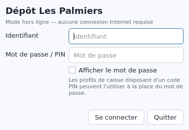
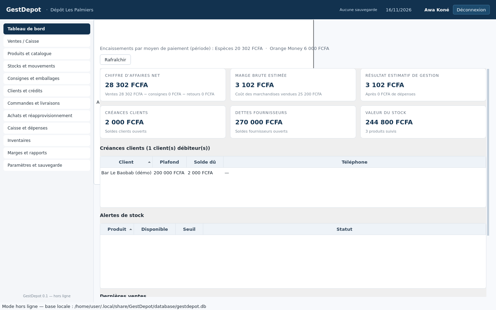
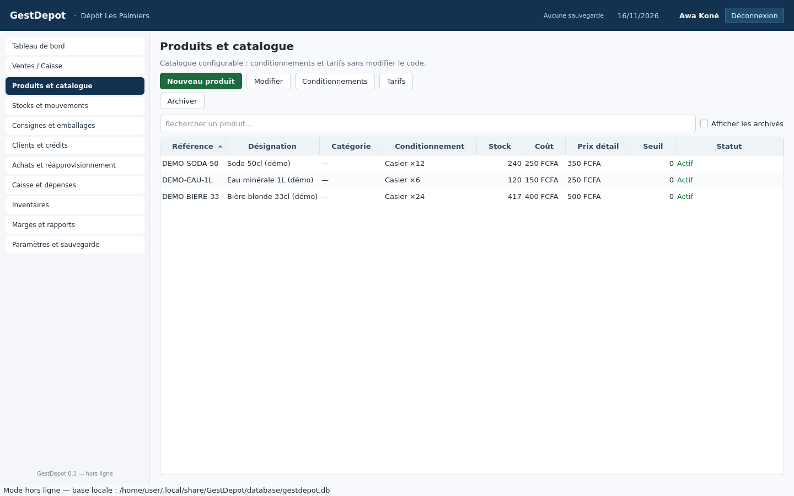
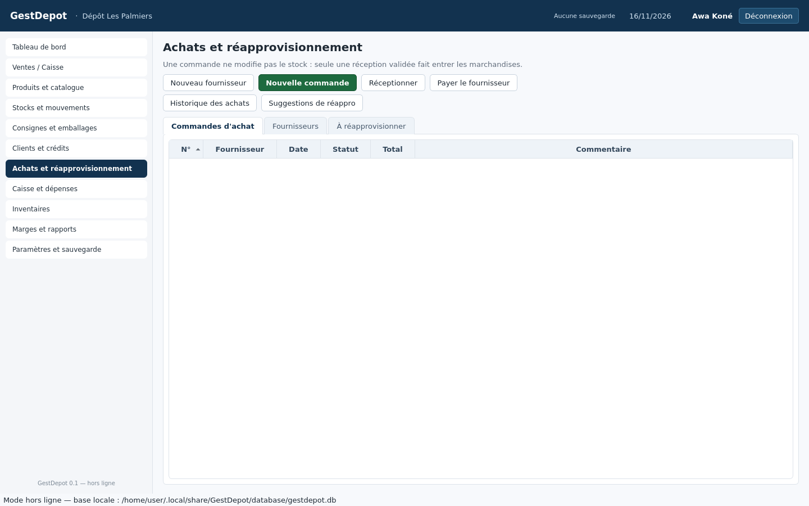
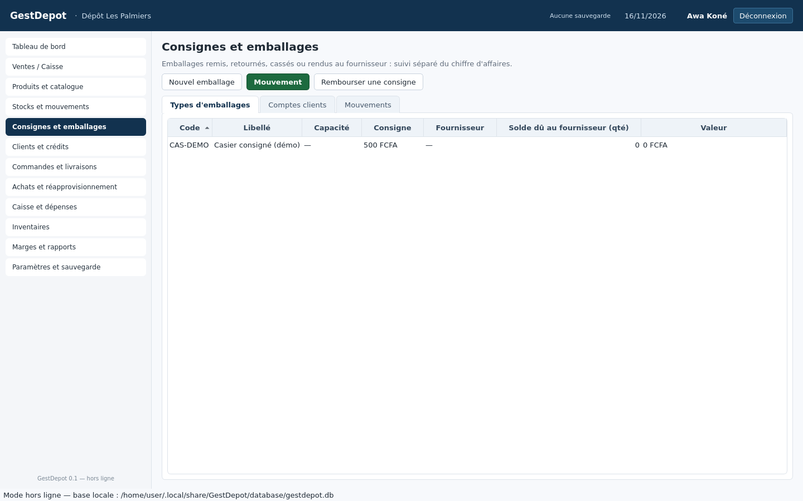
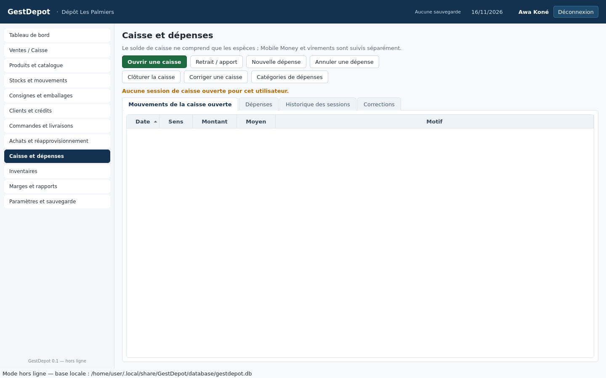
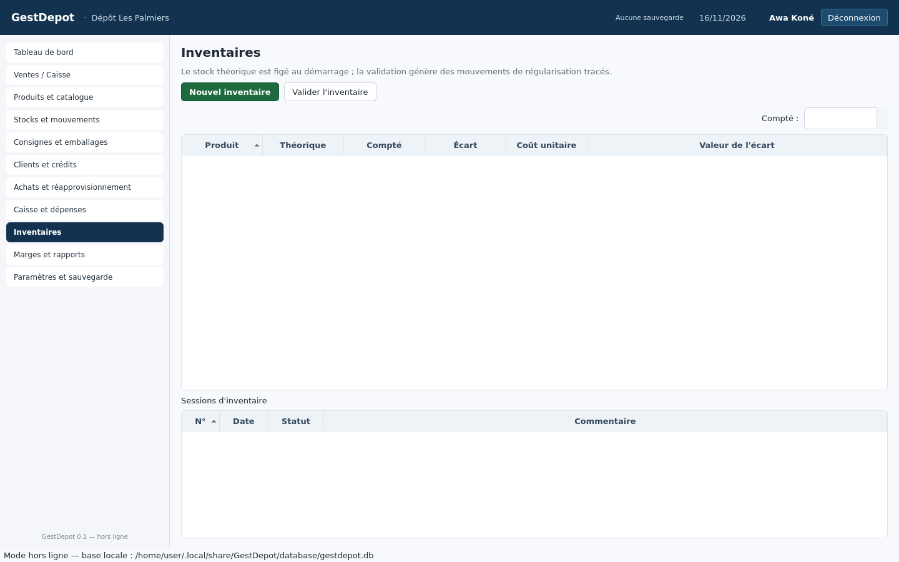
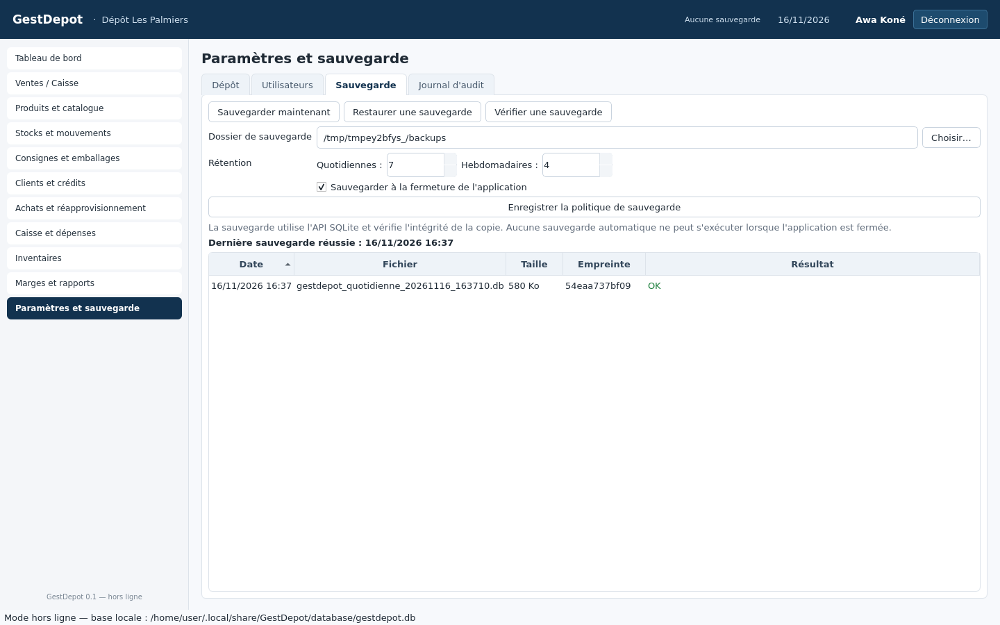
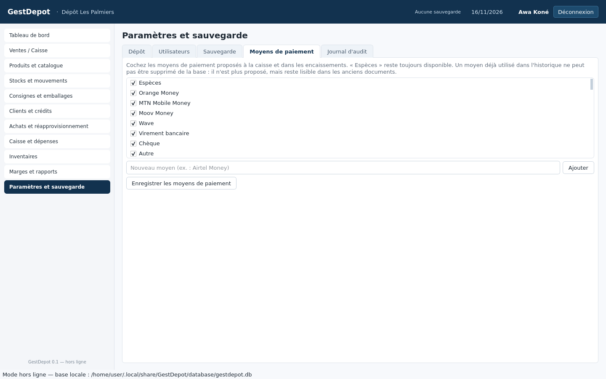

# USER_GUIDE.md — guide utilisateur GestDepot

Interface entièrement en français, devise **FCFA (XOF)**, navigation par le menu
de gauche. L'application fonctionne sans Internet : l'indicateur
« Mode hors ligne » est affiché en bas de la fenêtre.

## 1. Se connecter

1. Lancez GestDepot.
2. Au premier démarrage, l'assistant demande : nom du dépôt, identifiant,
   mot de passe (6 caractères minimum) et éventuellement un code PIN de caisse.
3. Saisissez ensuite votre identifiant et votre mot de passe. Un message neutre
   s'affiche en cas d'erreur ; après plusieurs échecs, la connexion est
   temporairement bloquée.

## 2. Tableau de bord

Choisissez la période (aujourd'hui, hier, 7 derniers jours, mois en cours).
Les cartes affichent le chiffre d'affaires net, la marge brute estimée, le
résultat estimatif de gestion, les créances clients, les dettes fournisseurs et
la valeur du stock. En dessous : les clients débiteurs, les alertes de stock et
les dernières ventes. Tous les chiffres proviennent des opérations enregistrées.

## 3. Préparer le catalogue

Menu **Produits et catalogue** :

1. **Nouveau produit** : référence (unique), désignation, unité de base, seuil
   minimum, prix d'achat courant, catégorie et marque.
2. **Conditionnements** : indiquez par exemple `Casier` × `24`. Ce facteur sert
   à convertir toute vente en unités de base ; il n'est jamais codé en dur.
3. **Tarifs** : un prix par liste (Détail, Gros…) et par conditionnement.
   Sans prix au conditionnement, l'application refuse la vente plutôt que de
   facturer un casier au prix de la bouteille.
4. **Archiver** : un produit déjà utilisé n'est jamais supprimé.

## 4. Réceptionner un achat

Menu **Achats et réapprovisionnement** :

1. **Nouveau fournisseur** si nécessaire (code, raison sociale, contact,
   conditions, délai habituel).
2. **Nouvelle commande** : produit, quantité en unités de base, prix convenu,
   plus une **remise** et des **frais d'approche** (transport, autres frais).
   Une commande **ne modifie pas le stock**. Les frais sont répartis au prorata
   des lignes et ajoutés au coût de chaque article à la réception : le coût moyen
   pondéré intègre donc le transport réel.
3. **Réceptionner** : saisissez les quantités réellement reçues, les quantités
   refusées et le coût constaté. Seules ces quantités entrent en stock ; le
   reliquat reste ouvert pour une réception ultérieure. Une facture fournisseur
   et le solde dû sont créés.
4. **Payer le fournisseur** (onglet Fournisseurs) : montant, moyen de paiement et
   facture éventuelle. Le solde dû diminue ; seules les espèces sortent de la
   caisse ouverte.
5. **Historique des achats** : commandes (annulation avec motif, réouverture
   auditée d'une commande soldée), paiements et factures avec reste dû.
6. L'onglet **À réapprovisionner** propose les produits sous seuil ; la
   proposition reste à valider par le gérant.

## 4 bis. Consignes et emballages

Menu **Consignes et emballages** : les emballages sont suivis séparément des
boissons, leur valeur n'entre pas dans le chiffre d'affaires.

1. **Nouvel emballage** : code, libellé, capacité et consigne unitaire
   (par exemple un casier consigné 500 FCFA).
2. **Mouvement** : remis au client, retourné par le client, reçu du fournisseur,
   rendu au fournisseur, cassé/perdu ou ajustement. Un retour supérieur au solde
   détenu par le client (ou dû au fournisseur) est refusé.
3. Onglet **Comptes clients** : quantité et valeur dues par client.
4. Onglet **Mouvements** : historique complet, avec le document d'origine.
5. **Rembourser une consigne** : le remboursement sort de la caisse sans créer de
   chiffre d'affaires.
6. Les consignes facturées lors d'une vente restent visibles dans l'écran de
   vente (bloc « Consigne ») et alimentent les mêmes comptes.

## 5. Vendre

Menu **Ventes / Caisse** :

1. Recherchez le produit (nom, référence, code-barres) — raccourci **F2**.
2. Choisissez le conditionnement et la quantité, puis **Ajouter**.
3. Sélectionnez le client (**F4**) ou laissez « Client comptoir ». Le tarif du
   client est appliqué automatiquement ; vous pouvez choisir une autre liste.
4. Une remise en FCFA est possible si votre rôle l'autorise.
5. Choisissez le moyen de paiement (**F6**) : espèces, Orange Money, MTN, Moov,
   Wave, virement, chèque.
6. Saisissez le montant encaissé (ou **Tout encaisser**) puis **Valider (F9)**.
7. **Paiement mixte** : le bouton ouvre la répartition du règlement sur plusieurs
   moyens (par exemple 5 000 en espèces + le reste par Wave). Chaque encaissement
   est numéroté et mouvemente la caisse avec son propre moyen ; le montant total
   ne peut pas dépasser le dû (le rendu de monnaie n'est pas encaissé).

Règles appliquées :

- le stock disponible est vérifié avant validation (vente bloquée si insuffisant) ;
- une quantité nulle ou négative est refusée ;
- une vente à crédit exige un client ; un dépassement de plafond est bloqué sauf
  autorisation du responsable ;
- le prix, la désignation, l'unité et le coût sont figés dans la vente ;
- une vente confirmée ne peut pas être supprimée : elle est annulée ou retournée.

**Modifier la quantité** d'une ligne (ou mettre 0 pour la retirer) et
**Retirer la ligne** agissent sur le panier sans rien écrire en base.

**Suspendre la vente (F8)** met le panier de côté sans toucher au stock, à la
caisse ni aux créances : aucun document n'est numéroté. **Ventes suspendues**
liste les paniers en attente, permet d'en **reprendre** un (il revient dans
l'écran de vente, prêt à être validé) ou d'en **abandonner** un (l'abandon est
inscrit au journal d'audit).

**Imprimer le dernier ticket** génère un ticket 80 mm imprimable
(dossier `documents/`).

## 6. Encaisser une créance

Menu **Clients et crédits** : sélectionnez le client, puis **Encaisser un
règlement**. Le paiement réduit la créance sans modifier le chiffre d'affaires
déjà enregistré. **Relevé de compte** affiche ventes, paiements et retours.

## 7. Retours et annulations

Bouton **Historique / retours** de l'écran de vente : la liste des ventes permet
de choisir **Retour de marchandise** ou **Annuler la vente**.

- Retour : sélectionnez la vente, saisissez les quantités à retourner ligne par
  ligne (les quantités déjà retournées sont affichées et le maximum est borné),
  cochez « revendable » si la marchandise réintègre le stock, indiquez le motif
  et le mode de remboursement (espèces, avoir, autre). Les quantités retournées
  ne peuvent pas dépasser les quantités vendues.
- Annulation : motif obligatoire. Le stock est réintégré, la créance soldée et
  l'opération inscrite au journal d'audit ; le document reste consultable et
  n'est jamais supprimé. La marchandise
revendable réintègre le stock ; la marchandise cassée n'y entre pas. Le
remboursement espèces ne dépasse jamais ce qui a été réellement encaissé.

## 8. Caisse et dépenses

1. **Ouvrir une caisse** : saisissez le fond de caisse compté. Une seule session
   par utilisateur ; le fond doit être exact car il sert de base au contrôle.
2. **Retrait / apport** : sortie d'espèces vers la banque, apport de monnaie, ou
   **correction autorisée** (motif obligatoire, réservée au rôle habilité).
3. Les encaissements de ventes, règlements de créances, remboursements, paiements
   fournisseurs et dépenses arrivent automatiquement dans le journal. Ils ne
   peuvent pas être saisis à la main : on ne fabrique pas un encaissement.
4. **Nouvelle dépense** : catégorie, bénéficiaire, montant, date, moyen de
   paiement, référence du justificatif et commentaire. Une dépense en espèces
   diminue le solde théorique ; un virement ou du Mobile Money sont suivis à part.
5. **Annuler une dépense** : motif obligatoire. La dépense reste dans l'historique
   avec le statut « Annulée » et le montant est réintégré à la caisse.
6. **Clôturer la caisse** : saisissez le montant compté ; l'écart est calculé et
   conservé, avec votre commentaire.
7. **Corriger une caisse** : seule procédure autorisée pour toucher à une session
   clôturée. La correction est un mouvement horodaté rattaché à la session, avec
   motif obligatoire ; le montant compté et l'écart sont recalculés et l'ancien
   écart reste dans le journal d'audit. L'onglet **Corrections** les liste.
8. **Catégories de dépenses** : ajoutez vos catégories ; une catégorie déjà
   utilisée ne peut pas être supprimée.

Le solde physique de caisse ne comprend **que les espèces** : Orange Money, MTN,
Moov, Wave, virements et chèques sont cumulés séparément sous le libellé de la
session.

## 9. Inventaires

1. **Nouvel inventaire** : choisissez le périmètre (tous les produits ou une
   sélection cochée) et le **seuil de contrôle** en FCFA (5 000 par défaut).
2. Le stock théorique et le coût moyen pondéré sont figés au démarrage : ils ne
   bougent plus même si des ventes ont lieu pendant le comptage.
3. **Saisir le comptage** (double-clic sur une ligne) : saisissez la quantité
   réellement comptée. L'écart en quantité et en valeur s'affiche ; au-delà du
   seuil, le dialogue signale que le contrôle est obligatoire.
4. **Contrôler les écarts** : pour chaque écart important, saisissez un constat
   (vol, casse, erreur de saisie…). Tant qu'un écart au-dessus du seuil n'est pas
   contrôlé, la validation est bloquée.
5. **Valider l'inventaire** : des mouvements de régularisation sont générés pour
   chaque écart. La session conserve le théorique, le compté, l'écart, le coût,
   l'utilisateur et la date — rien n'est effacé.
6. Un inventaire validé n'est plus modifiable : pour corriger, créez un **nouvel
   inventaire** (régularisation), la validation d'origine restant consultable.
7. **Abandonner** : un inventaire non validé peut être abandonné avec un motif ;
   il ne touche pas au stock et reste visible avec le statut « Abandonné ».

## 10. Rapports et exports

Menu **Marges et rapports** : choisissez le rapport et la période, puis
**Export Excel** ou **Export PDF**. Les exports sont des copies de consultation :
ils ne modifient jamais les données. Les tickets et rapports PDF incluent le nom
et les coordonnées du dépôt.

## 11. Raccourcis clavier

| Touche | Action |
|---|---|
| F2 | Rechercher un produit |
| F3 | Ajouter la ligne au panier |
| F4 | Choisir le client |
| F6 | Choisir le moyen de paiement |
| F9 | Valider la vente |
| Échap | Vider le panier / fermer |

## 11 bis. Sauvegardes et restauration

Onglet **Sauvegarde** des paramètres :

1. **Dossier de sauvegarde** : laissez vide pour le dossier par défaut, ou
   **Choisir…** pour un disque externe / une clé USB (support distinct
   recommandé, §8.2).
2. **Rétention** : nombre de sauvegardes **quotidiennes** (7 par défaut) et
   **hebdomadaires** (4 par défaut) conservées. Au-delà, les plus anciennes sont
   purgées; une archive par semaine reste disponible au-delà de la fenêtre
   quotidienne.
3. **Sauvegarder à la fermeture** : activé par défaut ; décochez si la
   sauvegarde de fermeture ralentit votre poste.
4. **Sauvegarder maintenant** : copie cohérente via l'API SQLite, contrôle
   `PRAGMA integrity_check`, empreinte SHA-256 enregistrée avec la date et la
   taille. La sauvegarde automatique quotidienne se déclenche au premier
   démarrage de la journée.
5. **Vérifier une sauvegarde** : recontrôle l'intégrité d'un fichier existant.
6. **Restaurer une sauvegarde** : réservé aux administrateurs. Une copie de
   sécurité de la base actuelle est créée avant tout remplacement ; une
   sauvegarde invalide est toujours refusée. Redémarrez ensuite l'application.

Limite expliquée à l'écran : l'application étant hors ligne, aucune sauvegarde
automatique ne peut s'exécuter si le poste est éteint ou l'application fermée.

## 11 ter. Moyens de paiement

Onglet **Moyens de paiement** des paramètres : cochez les moyens proposés à la
caisse et dans tous les encaissements (ventes, clients, fournisseurs, consignes,
dépenses). « Espèces » est toujours proposé — c'est le moyen qui alimente la
caisse physique. Pour ajouter un opérateur non listé (Airtel Money, Moov Flooz…),
saisissez son nom puis **Ajouter** ; le code interne est dérivé du libellé.

Décocher un moyen ne supprime aucune donnée : il n'est plus proposé à la saisie,
mais les ventes et mouvements existants restent lisibles avec leur libellé.

## 12. En cas de problème

- **Message « Permission refusée »** : votre rôle ne permet pas cette action ;
  demandez au responsable.
- **« Stock insuffisant »** : vérifiez le stock réel (menu Stocks) ou réceptionnez
  un achat.
- **Application fermée brutalement** : relancez-la. Une vente en cours de
  validation est soit entièrement enregistrée, soit entièrement annulée — aucun
  état partiel ne subsiste.
- **Restauration de données** : voir `ADMIN_GUIDE.md`.
